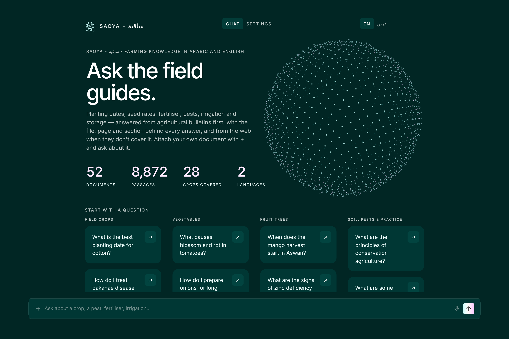
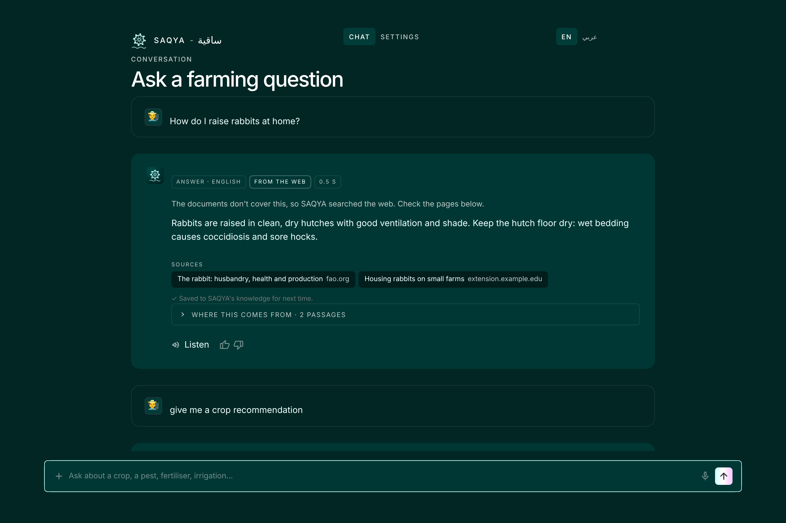
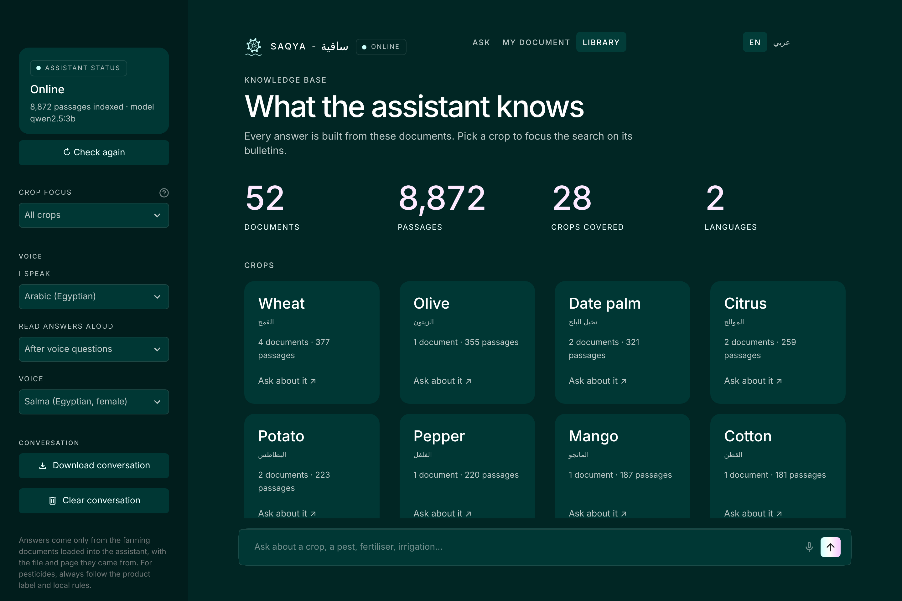
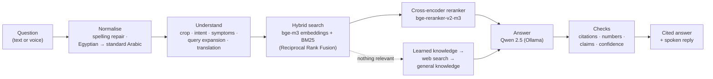

<div align="center">

# SAQYA AI (ساقية)

### A bilingual, citation-grounded farming assistant for Arabic, Egyptian Arabic and English

Ask a farming question by text or voice. SAQYA retrieves the answer from trusted agricultural bulletins and
replies in the same language, citing the document and page it came from.


[Features](#features) · [How it works](#how-it-works) · [Results](#results) · [Quick start](#quick-start) ·
[API](#api) · [Team](#for-the-team) 

</div>

---

## About

Farmers in Egypt and the Arab world often cannot find reliable, practical answers in their own words and
language. SAQYA (Arabic for a traditional water wheel) is an AI assistant that answers questions about crops, soil,
irrigation, fertilisers, pests, diseases, harvest and storage from a library of **52 agricultural bulletins**
(**8,872 indexed passages**, **28 crops**, Arabic and English).

It is built on **Retrieval-Augmented Generation (RAG)**: every answer is written from passages retrieved from the
library and checked against them before the farmer sees it. It runs **locally**: the language model runs on
your own machine through Ollama, so no paid API is needed for answers.

> SAQYA gives general agricultural guidance. For decisions involving pesticides, doses or serious crop losses,
> check with your local agricultural extension officer.

---

## Features

| Capability | Description |
|---|---|
| **Multilingual** | Ask in standard Arabic, **Egyptian Arabic** («إمتى أزرع الأوطة؟») or English; the answer comes back in the same language |
| **Source citations** | Each answer cites the bulletin and page it used, with the supporting passages available for inspection |
| **Hybrid retrieval and reranking** | Meaning-based search (bge-m3 embeddings) and keyword search (BM25), fused and re-sorted by a cross-encoder |
| **Answer verification** | Unsupported numbers, wrong citations, mixed-language or garbled text are caught and repaired before display; each statement is checked against its source |
| **Voice assistant** | Speak your question (Whisper speech recognition) and hear the answer in **Egyptian or formal Arabic** (Gemini or Microsoft voices) |
| **Document question answering** | Attach a PDF, Word, TXT or Markdown file and ask about it, or have it summarised or explained |
| **Fallback sources** | When the bulletins have no answer: what SAQYA learned before → a web search with cited pages → general knowledge (clearly marked) |
| **Continuous learning** | Cited web passages and attached documents can be kept for future questions (and forgotten from Settings) |
| **Planting calendar** | "What can I plant in November in sandy soil in Minya?" gets an answer by month, soil type and region (Delta / Upper Egypt) |
| **Confidence and abstention** | Calibrated confidence: declines off-topic questions and asks for missing details, such as the crop |
| **Bilingual interface** | English and Arabic UI with full right-to-left layout |

---

## Screenshots

| Home | Attached document | Web answer |
|:---:|:---:|:---:|
|  |  |  |

| Library | Settings | Learned knowledge |
|:---:|:---:|:---:|
|  |  |  |

---

## How it works



1. **Normalise.** Misheard or mistyped farming words are repaired (voice input often turns «محاصيل» into «مع حصيل»),
   and Egyptian expressions are rewritten into standard Arabic for searching.
2. **Understand.** The question is read for its crop, intent, symptoms and conditions (soil, region, month). It is
   expanded with the bulletins' own vocabulary and translated, so Arabic questions can find English documents and
   the reverse.
3. **Retrieve.** Embedding search and BM25 keyword search run together and are fused. The 30 best candidates are
   re-sorted by a multilingual cross-encoder.
4. **Generate.** Qwen 2.5 writes a short, practical answer from the top passages only.
5. **Verify.** Citations are fixed, numbers not found in the cited passage are removed, broken or mixed-language
   text is blocked and retried, and each statement is checked against its evidence. A calibrated confidence model
   decides whether to answer, add a caution, ask for missing details or abstain.

---

## Results

Measured with the project's own evaluation framework on **held-out test questions** that were never used to choose
any setting (standard Arabic, Egyptian Arabic, English and cross-language).

**Retrieval** (52 test questions):

| Metric | Original hybrid search | Current pipeline | Change |
|---|:---:|:---:|:---:|
| Recall@5 | 0.797 | **0.934** | +0.137 |
| Recall@10 | 0.893 | **0.947** | +0.054 |
| MRR@10 | 0.792 | **0.920** | +0.128 |
| nDCG@10 | 0.783 | **0.910** | +0.127 |
| A relevant passage in the top 5 | 87% | **98%** | |

**Answers** (59 test questions, Qwen 2.5 7B):

| Metric | Before | After |
|---|:---:|:---:|
| Correct answers | 76.9% | **82.7%** |
| Right passage given to the model | 84.6% | **92.3%** |
| Statements supported by their sources | 99.0% | **99.6%** |
| Off-topic questions refused | 100% | 100% |

Full methodology, every experiment and what was *not* evaluated: [`docs/ai-ml-engineering.md`](docs/ai-ml-engineering.md).

---

## Tech stack

| Layer | Technology |
|---|---|
| Backend API | FastAPI, Pydantic |
| Frontend | Streamlit (English / Arabic, RTL) |
| Language model | Qwen 2.5 (3B or 7B) via Ollama |
| Embeddings | BAAI/bge-m3 (sentence-transformers) |
| Reranker | BAAI/bge-reranker-v2-m3 |
| Vector database | ChromaDB |
| Keyword search | BM25 with Arabic light stemming and English Snowball stemming |
| Speech | faster-whisper (speech-to-text), Gemini TTS / Microsoft Edge TTS |
| Documents | pdfminer, PyMuPDF, pypdf, python-docx |
| Web search | ddgs + trafilatura |
| Observability | Optional LangSmith tracing; stage timings in the logs |
| Testing | pytest (307 tests, no GPU / Ollama needed) |

---

## Quick start

**Requirements:** Python 3.11 or 3.12, Git, [Ollama](https://ollama.com). An NVIDIA GPU is optional but makes
answers much faster.

```bash
# 1. Code and dependencies
git clone https://github.com/abdelrahman2366/Saqya-RAG-AI.git
cd Saqya-RAG-AI
python -m venv .venv
.venv\Scripts\activate                     # macOS / Linux: source .venv/bin/activate
pip install -r requirements.txt -r backend/requirements.txt -r frontend/requirements.txt

# 2. Models
ollama pull qwen2.5:7b                     # or qwen2.5:3b on a smaller machine
cd backend
python scripts/download_models.py reranker

# 3. Knowledge base: download saqya-vector-store.zip from the Releases page and unzip it into backend/

# 4. Settings (switches on the evaluated configuration)
copy .env.example .env                     # macOS / Linux: cp .env.example .env
python scripts/enable_ai_layers.py

# 5. Run
uvicorn app.main:app --reload              # backend  → http://localhost:8000
# in a second terminal:
cd frontend && streamlit run app.py        # chat app → http://localhost:8501
```

The step-by-step guide, including rebuilding the knowledge base from the PDFs with the notebooks, is in
[`ONBOARDING.md`](ONBOARDING.md).

---

## Configuration

All settings live in `backend/.env` (template: `backend/.env.example`). The most useful:

| Setting | Default | Purpose |
|---|---|---|
| `OLLAMA_MODEL` | `qwen2.5:3b` | Answer model (`qwen2.5:7b` gives better Arabic and citations) |
| `RERANKER_ENABLED` | `false`* | Cross-encoder reranking of search results |
| `QUERY_EXPANSION_ENABLED` | `false`* | Extra search phrasings from the bulletins' vocabulary |
| `KEYWORD_WEIGHT` / `KEYWORD_SEAT` | `1.0` / `true`* | Balance between embedding and keyword search |
| `CONFIDENCE_CALIBRATION_ENABLED` | `false` | Calibrated answer / qualify / ask / abstain decisions |
| `WEB_SEARCH`, `LEARNING`, `GENERAL_KNOWLEDGE` | `true` | Sources used when the library has no answer |
| `GEMINI_API_KEY` | empty | Optional: natural Gemini voices (falls back to Microsoft voices) |
| `LANGSMITH_TRACING_ENABLED` | `false` | Optional tracing of every pipeline stage |
| `VISION_ENABLED` | `false` | Plant-disease detection from photos (in development) |

\* `python backend/scripts/enable_ai_layers.py` sets the evaluated values (reranker and expansion on, keyword
weight 0.5, keyword seat off). `--off` restores the defaults. Every optional layer can be switched off, and the
original pipeline stays available.

---

## Using SAQYA

- **Chat:** type a question in Arabic, Egyptian Arabic or English. Each answer shows its origin (library,
  your document, learned, web or general knowledge) and its sources, and can be rated as helpful or not helpful.
- **Voice:** press the microphone, speak, and SAQYA answers in text and speech. Choose Egyptian or formal Arabic and
  the voice in **Settings**.
- **Documents:** press **+** to attach a file, then ask about it or request a summary or an explanation of a
  section. Documents stay only for the current session.
- **Settings:** interface language, voice, web search / learning / general-knowledge switches, and a list of what
  SAQYA has learned, which you can delete.

---

## API

Interactive documentation runs at `http://localhost:8000/docs` while the backend is up.

| Method | Endpoint | Description |
|---|---|---|
| `GET` | `/health` | Status of the vector store, LLM, voice and optional AI layers |
| `POST` | `/query` | Ask a question → answer, sources, origin, language |
| `GET` | `/library` | Documents, crops and passage counts |
| `POST` | `/voice/transcribe` | Speech → text |
| `GET` | `/voice/stream` · `POST` `/voice/speak` | Text → speech |
| `POST` | `/documents` | Attach a document (then `/documents/{id}/query`, `/explain`, `/clean.pdf`) |
| `GET` / `DELETE` | `/knowledge` | View or forget learned knowledge |
| `POST` | `/feedback` | Rate an answer |
| `POST` | `/vision/diagnose` | Plant-disease detection from a photo (extension point; no model yet) |

```bash
curl -X POST http://localhost:8000/query -H "Content-Type: application/json" \
     -d '{"question": "When should wheat be planted in Egypt?"}'
```

---

## Testing and evaluation

```bash
cd backend
python -m pytest -q                                    # 307 tests, uses fake models
python scripts/evaluate.py --translate --reranker      # retrieval experiments E1–E7 on the real data
python scripts/evaluate.py --answers --answers-limit 60  # end-to-end answer quality with the LLM
```

The evaluation reports Recall@K, Precision@5, MRR@10, nDCG@10, answer correctness, faithfulness, citation
precision and latency, on a fixed validation/test split. Results go to `evaluation/results/` as JSON, CSV and
Markdown.

---

## Project structure

```
Saqya-RAG-AI/
├── backend/
│   ├── app/
│   │   ├── api/routes/      # query, voice, documents, vision endpoints
│   │   ├── core/            # settings, tracing
│   │   ├── evaluation/      # metrics, dataset split, experiment runner
│   │   ├── schemas/         # request / response models
│   │   └── services/        # RAG pipeline, retrieval, reranker, grounding, speech, web search…
│   ├── scripts/             # evaluate, fine-tune, download models, package the vector store
│   └── tests/
├── frontend/                # Streamlit chat app and API client
├── notebooks/               # PDF cleaning, data checks, vector-store build, Egyptian fine-tuning
├── data/                    # evaluation questions, fine-tuning data (PDFs are not in git)
├── docs/                    # AI/ML report, technical reference, CV handoff, screenshots
├── evaluation/results/      # measured evaluation reports
└── ONBOARDING.md            # setup guide for new team members
```

---

## For the team

- **New to the project?** Start with [`ONBOARDING.md`](ONBOARDING.md).
- **Building plant-disease detection from photos?** Read [`docs/computer-vision-handoff.md`](docs/computer-vision-handoff.md).
- **Full technical reference** (every setting, API detail, grounding rules, troubleshooting):
  [`docs/technical-reference.md`](docs/technical-reference.md).

House rules:
- New features are optional and off by default.
- Measure with `scripts/evaluate.py` before switching anything on.
- Never commit `.env` files, keys, models or the vector store.
- Open pull requests from a feature branch with tests passing.

---

## Acknowledgements

- Arabic crop-production bulletins and English agricultural guides, including FAO publications (the International
  Code of Conduct on Pesticide Management, *Save and Grow*, *The State of Food and Agriculture 2025*) and other
  open agricultural references. <!-- TODO: list each publisher / link -->
- Models: [BAAI bge-m3 and bge-reranker-v2-m3](https://huggingface.co/BAAI), [Qwen 2.5](https://ollama.com/library/qwen2.5),
  [faster-whisper](https://github.com/SYSTRAN/faster-whisper).

## License

No license has been chosen yet. Until one is added, all rights are reserved by the authors. The source documents
remain under their publishers' terms.
