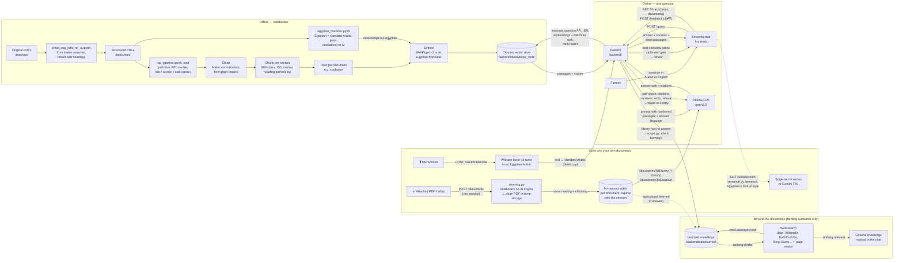
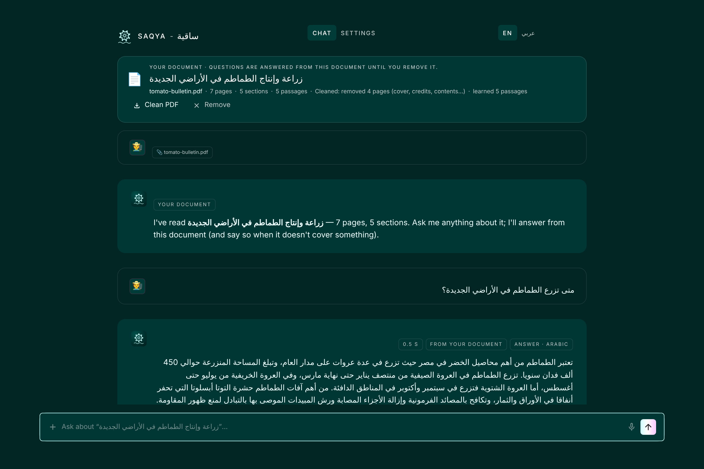
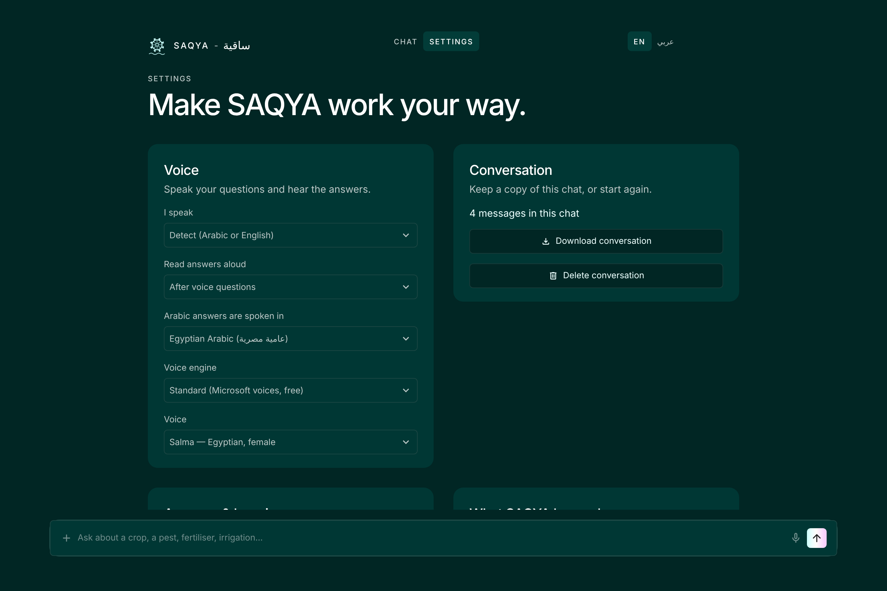
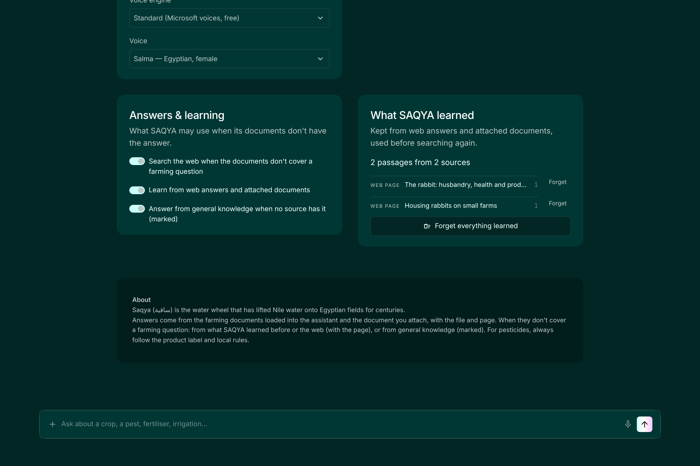

# 🌾 SAQYA AI — ساقية · a RAG chatbot for farmers

**SAQYA AI** (*ساقية* — the water wheel that has lifted Nile water onto Egyptian fields for centuries) answers farmers' questions about crops, soil, pests, irrigation, harvest and storage
**from a collection of agricultural documents first**, in **Arabic or English**. The documents can be
in either language too: an Arabic question can be answered from an English guide and the other way
round, and the answer always comes back in the language of the question. Every answer cites the file
and page it came from. When the documents don't cover a **farming** question, SAQYA looks further — what it
learned before, then the web, then general knowledge — and every answer says where it came from; anything that
isn't about farming is still politely refused.

It runs fully locally: original PDFs → rebuilt as clean, structured PDFs (`data/clean/`) → read section
by section, chunked and embedded in a notebook → stored in a Chroma vector database → served by a
FastAPI backend that calls a local **Ollama** LLM → shown in a Streamlit chat app (dark-teal design from
`DESIGN.md`, with the evidence behind every answer, ratings, and a Settings page for the voice and the
conversation). Answers always come back in the language of the question: English in, English out; Arabic in,
Arabic out.

Two more ways to use it:
- **🎙 Voice assistant** — ask with your voice, in Egyptian Arabic too ("إمتى أزرع الأوطة؟"). A local Whisper
  model writes the question down, it is rewritten into the standard Arabic of the bulletins, and the answer
  is spoken back **live** — it starts talking within a moment, sentence by sentence — in **Egyptian Arabic or
  formal Arabic** (Settings), with the free Microsoft voices or Google's more natural Gemini voice.
- **＋ Attach a document** — drop your own bulletin, guide or report (PDF, Word or text) into the chat with the
  ＋ in the question box. A PDF is first rebuilt as a **clean PDF of its own** by the same no-AI cleaning engine as
  `clean_rag_pdfs_no_ai.ipynb` (cover, contents and headers/footers gone, sections recovered), kept in temporary
  storage for your session only, and indexed from that clean copy. Ask about it, have it — or one of its
  sections — explained, and keep asking: follow-up questions ("and how much water does it need?") stay on the
  document. Answers come from that file with pages; what it doesn't cover is answered from the library, and said so.
- **🌐 Beyond the documents, and it learns** — "give me a crop recommendation", "how do I raise rabbits?": a farming
  question the library can't answer is searched on the web (free metasearch, no key), answered from the pages
  with links to them, and the passages it cited are **kept for next time** — together with what attached
  agricultural documents say. Settings shows what SAQYA learned and can forget any of it.

And the search model itself can learn Egyptian: **`notebooks/egyptian_finetune.ipynb`** teaches the same
`BAAI/bge-m3` embedding model Egyptian farming questions by distillation from Egyptian / standard-Arabic pairs
built from the documents — no AI service, no hand labelling — keeps it only if it scores better, and the pipeline
and backend then use it automatically ([Egyptian Arabic model](#egyptian-arabic-model)).

> ✏️ Placeholders marked with ✏️ need your own content (your documents, results, screenshots).

---

## Contents
- [Architecture](#architecture)
- [Tech stack](#tech-stack)
- [Project structure](#project-structure)
- [Domain & data](#domain--data)
- [Setup](#setup) — [prerequisites](#1-prerequisites) · [notebook](#3-build-the-vector-store-notebook) · [backend](#4-run-the-backend) · [frontend](#5-run-the-frontend)
- [Environment variables](#environment-variables)
- [The chat app](#the-chat-app) — [voice assistant](#voice-assistant) · [attached documents](#attached-documents) · [beyond the documents](#beyond-the-documents-and-learning) · [answer language](#answer-language)
- [API reference](#api-reference)
- [Evaluation results](#evaluation-results)
- [Screenshots](#screenshots)
- [Arabic support](#arabic-support) — [Egyptian Arabic model](#egyptian-arabic-model)
- [How grounding works](#how-grounding-works)
- [Troubleshooting](#troubleshooting)

---

## Architecture



The vector store, embedding model and keyword (BM25) index are loaded **once at startup** (FastAPI
lifespan); nothing is rebuilt per request.

## Tech stack

| Layer | Choice | Why |
|---|---|---|
| PDF parsing | `pdfminer.six` (glyphs read right-to-left, fragment-aware line rebuild), `pypdf` as fallback | the only option tested that keeps both Arabic letters and numbers intact and reads Arabic tables row by row (see Arabic support) |
| Data checks | `wordfreq` | measures how many extracted words are real Arabic/English words, to catch garbled PDFs |
| Embeddings | `BAAI/bge-m3` (1024-d), optionally fine-tuned on Egyptian Arabic (`models/bge-m3-egyptian`) | 100+ languages, strong on Arabic, one vector space for both languages so cross-language retrieval works; the fine-tune adds the way Egyptian farmers ask |
| Keyword search | BM25 (own implementation) + Arabic light stemming, `snowballstemmer` for English | finds exact names (pests, varieties, fertilisers) the embedding model misses; a crop named in the question gets seats for its own bulletin's passages |
| Vector store | Chroma (persistent, cosine) | zero-config, saves to a folder the backend can load |
| LLM | Ollama + `qwen2.5:3b` | free, local, runs on a laptop, and supports Arabic (`llama3.2` doesn't officially) |
| Backend | FastAPI, Pydantic, pydantic-settings | typed request/response, auto Swagger docs |
| Frontend | Streamlit + custom theme (`DESIGN.md`) | chat UI in pure Python; the theme and CSS tokens follow the design file |
| Tests | pytest + FastAPI `TestClient` | fake retriever/LLM, no Ollama needed |
| Speech to text | `faster-whisper` + Whisper `large-v3-turbo` (local) | understands Egyptian colloquial Arabic; no PyTorch needed; `small` for slow PCs |
| Egyptian dialect | own word list (`dialect.py`) + the Egyptian fine-tune of bge-m3 | "إزاي/إمتى/عايز/الأوطة/الدرة" → "كيف/متى/أريد/الطماطم/الذرة" so keyword search matches the standard-Arabic bulletins; the fine-tuned embeddings understand what the list misses |
| Text to speech | `edge-tts` (Microsoft neural voices: Egyptian Salma / Shakir, Saudi Zariyah / Hamed) streamed sentence by sentence; optional **Gemini TTS** (`gemini-3.1-flash-tts-preview`); browser voice as fallback | free natural voices spoken live; Gemini follows a style instruction, so one voice speaks warm Egyptian or formal standard Arabic; the Egyptian style also rewrites the answer's everyday words (`dialect.to_egyptian`) |
| Beyond the documents | `ddgs` (free metasearch: Wikipedia, DuckDuckGo, Bing, Brave, Google, Mojeek…), `trafilatura` (main text of a page), PyMuPDF (PDFs on the web) | no API key, no AI service; the pages are ranked with the library's own hybrid search and embedding model, so only passages that answer are used and cited |
| Learning | own store (`learning.py`: JSONL + NumPy vectors in `backend/data/learned/`) | keeps cited web passages and attached agricultural documents; deduplicated, size-capped, searchable like the library, forgettable from Settings |
| Attached documents | the PDF-cleaning notebook's engine (`cleaning.py`, PyMuPDF) → a clean PDF (Playwright Chromium, MuPDF as fallback), then the indexing notebook's reading and chunking (`extraction.py`); `python-docx` for Word | an attached document, whatever its layout, is read from a clean copy just like the indexed library |
| Packaging | Docker (backend) | reproducible deployment |

## Project structure

```
agri-rag-assistant/
├── data/
│   ├── raw/                      # the original agricultural PDFs (not committed)
│   ├── clean/                    # the same PDFs rebuilt clean and structured — what gets indexed (not committed)
│   ├── eval_questions.json       # 88 test questions: 78 farming (AR / EN / cross-language), 10 out-of-scope
│   ├── eval_questions_egyptian.json  # q01–q55 asked again in Egyptian Arabic (e01–e55), same answers
│   └── eval_questions_v1.json    # the earlier 32-question set (runs 1–2)
├── notebooks/
│   ├── clean_rag_pdfs_no_ai.ipynb  # step 1: rebuild every PDF clean and structured (no AI, no API calls)
│   ├── data_check.ipynb          # step 2: flags duplicate, scanned, garbled and off-topic files
│   ├── egyptian_finetune.ipynb   # optional step: teach bge-m3 Egyptian Arabic (no AI) → models/bge-m3-egyptian
│   ├── rag_pipeline.ipynb        # step 3: load → clean → chunk → embed → retrieve → evaluate → export
│   └── results/                  # eval_results.csv / .md and the fine-tune's results written by the notebooks
├── models/bge-m3-egyptian/       # the Egyptian fine-tune, if you made it (≈2.2 GB, not committed)
├── backend/
│   ├── app/
│   │   ├── main.py               # FastAPI app, CORS, startup loading (lifespan)
│   │   ├── api/routes/query.py   # GET /health, POST /query, GET /library, POST /feedback
│   │   ├── api/routes/voice.py   # POST /voice/transcribe, GET /voice/stream (live), POST /voice/speak
│   │   ├── api/routes/documents.py  # attach a document (per session), ask about it, explain it, its clean PDF
│   │   ├── core/config.py        # settings from .env
│   │   ├── schemas/query.py      # request / response models (query, passages, library, feedback)
│   │   ├── services/
│   │   │   ├── retrieval.py      # load Chroma + embedder, hybrid search, relevance gate
│   │   │   ├── lexical.py        # BM25 keyword index with Arabic/English stemming
│   │   │   ├── glossary.py       # Arabic ↔ English farming terms, document topics
│   │   │   ├── generation.py     # prompt template, translation, Ollama call
│   │   │   ├── grounding.py      # answer checks and repairs (also used by the evaluation)
│   │   │   ├── rag_service.py    # dialect → translate → search → refuse or generate → check → answer language → sources
│   │   │   ├── conversation.py   # spots follow-up questions ("and how much water?") and what they refer to
│   │   │   ├── beyond.py         # library has no answer: learned knowledge → web → general knowledge
│   │   │   ├── scope.py          # is the question about agriculture? (LLM yes/no, word list as fallback)
│   │   │   ├── web_search.py     # free metasearch, page reading (HTML / PDF), passages
│   │   │   ├── learning.py       # what SAQYA learned from the web and attached documents
│   │   │   ├── dialect.py        # Egyptian colloquial Arabic → standard Arabic
│   │   │   ├── speech.py         # Whisper (speech → text); Edge and Gemini voices, Egyptian / formal style
│   │   │   ├── extraction.py     # read / clean / chunk one file, ported from the notebook
│   │   │   ├── cleaning.py       # the PDF-cleaning notebook's engine: rebuilds an attached PDF as a clean PDF
│   │   │   └── documents.py      # attached documents: clean, index, keep per session (temporary), answer, explain
│   │   └── utils/
│   │       ├── logging_config.py
│   │       └── text.py           # Arabic/English detection and normalisation
│   ├── data/vector_store/        # written by the notebook (Chroma + rag_config.json)
│   ├── data/learned/             # what SAQYA learned (created on first use; not committed)
│   ├── tests/                    # pytest suite (235 tests: Arabic, hybrid search, answer checks, polishing, voice, documents, web, learning)
│   │   └── data/                 # two deliberately messy PDFs (Arabic, English) for the cleaning tests
│   ├── requirements.txt
│   ├── .env.example
│   └── Dockerfile
├── frontend/
│   ├── app.py                    # Streamlit app: Chat (text, voice, attached documents) and Settings (English / Arabic, RTL)
│   ├── ui_text.py                # every piece of UI text, English and Arabic (suggested questions too)
│   ├── theme.py                  # DESIGN.md CSS, particle-sphere hero, browser-voice player
│   ├── api_client.py             # wrapper for the backend API
│   ├── assets/saqya-icon.png     # the water-wheel icon (browser tab and chat avatar)
│   ├── .streamlit/config.toml    # dark-teal theme from DESIGN.md
│   ├── .env.example
│   └── requirements.txt
├── docs/screenshots/
├── requirements.txt              # notebook dependencies
└── README.md
```

## Domain & data

**Domain:** practical crop and farm management for farmers — planting, land preparation, fertilizer
use, pests and diseases, irrigation, harvest and grain storage — from Arabic and English guides.

**Documents used:** 53 cleaned PDFs in `data/clean/` (2,841 pages), 52 of them indexed — `NEW_sugar_beet.pdf`
is an exact copy of the sugar-beet bulletin and is skipped. 40 are Arabic, 12 English. 39 are about one
crop (28 crops in all); the rest are general references: a farmer's handbook, key-facts and
general-knowledge books, the FAO pesticide code of conduct (Arabic and English), Save and Grow,
conservation agriculture, The State of Food and Agriculture 2025, a food-security and climate-change
report, an agricultural-knowledge-and-poverty paper, an environment-and-agriculture unit and an Arabic
agricultural encyclopedia. `GET /library` lists every file with its title, crop, language, pages and
passages (the chat's opening screen shows the totals).

| Crops | Documents |
|---|---|
| Field crops | wheat (4, incl. one English study), maize (3, incl. one English study), cotton, sugar beet, sugarcane (2), rice diseases, faba bean, soybean, sesame, sunflower, sorghum, flax, Egyptian clover (English study) |
| Vegetables | tomato, potato (2), onion (3), pepper, eggplant, cucumber, zucchini, cabbage, watermelon, cantaloupe, strawberry, vegetable nurseries |
| Fruit trees | citrus (2), mango, olive, date palm (2, incl. one English study) |

Two downloads are **not** in `data/clean/`: `cc7852en.pdf` is a 4-page scan with no text layer (it needs
OCR first), and `مفكرة-العنب-للمزارعين_250927_011327.pdf` (grape notebook) uses a font whose letters map to
the wrong characters, so its text can't be recovered. ✏️ Add the publisher / link for each file if you
publish the repo.

**To reproduce:** put the original PDFs in `data/raw/`, run `notebooks/clean_rag_pdfs_no_ai.ipynb` to
write the cleaned copies to `data/clean/` (same file names), then follow the setup below.

**Data checks (notebook section 2.1 and `data_check.ipynb`):** all 52 indexed files are read as
structured documents (title, sections, sub-sections); 4 pages that were mostly broken font were skipped;
2,167 sentences and 145 passages repeated across or inside files were dropped; words written with a
font's wrong glyph were repaired (one zucchini bulletin draws ص, ض and ش as س: 171 distinct words). Result:
**≈ 8,900 passages**, about 8,500 of them carrying their section heading path.

## Setup

### 1. Prerequisites

| Tool | Version | Check |
|---|---|---|
| Python | **3.11 or 3.12** | `python --version` |
| Ollama | latest | `ollama --version` |
| Git | any recent | `git --version` |

> The current pinned versions of pandas, torch and pydantic-settings require Python 3.11+, so
> Python 3.10 won't work with this `requirements.txt`.

Pull the LLM once (≈2 GB):

```bash
ollama pull qwen2.5:3b
```

With a GPU that has 8 GB of memory or more (or 16 GB of RAM on CPU), `qwen2.5:7b` (≈5 GB) follows the
citation and number rules noticeably better and writes better Arabic: `ollama pull qwen2.5:7b`, then set
`OLLAMA_MODEL=qwen2.5:7b` in `backend/.env` (the notebook reads it too).

### 2. Clone and install

```bash
git clone https://github.com/<your-username>/rag-assistant-app.git
cd rag-assistant-app
python -m venv .venv
.venv\Scripts\activate            # Windows
# source .venv/bin/activate       # macOS / Linux

# Linux only, optional: CPU-only PyTorch avoids a ~2 GB CUDA download
# pip install torch --index-url https://download.pytorch.org/whl/cpu

pip install -r requirements.txt -r backend/requirements.txt -r frontend/requirements.txt

# optional: Chromium for the clean PDFs made from attached documents (MuPDF draws a plainer one without it)
python -m playwright install chromium
```

### 3. Build the vector store (notebooks)

0. Put the original PDFs in `data/raw/` and run `notebooks/clean_rag_pdfs_no_ai.ipynb` (no AI, no API
   calls). It writes one clean, structured PDF per file to `data/clean/`: cover pages, author lists and
   other front matter removed, a contents list, and real headings (title › section › sub-section) in a
   readable font. The pipeline reads `data/clean/` whenever it holds documents, otherwise `data/raw/`.
1. Run `notebooks/data_check.ipynb` (it checks `data/clean/`, or `data/raw/` if that is empty). It flags exact and
   near-duplicate files, scanned or garbled PDFs, files that repeat themselves and policy/off-topic
   documents, and writes `notebooks/results/files_to_remove.txt`. Read the samples it prints for
   REVIEW files, then move what you don't want out of `data/clean/` (its last cell can do this for you).
   Some problems are handled automatically by the pipeline, so you don't have to remove those files:
   exact duplicate files are skipped, repeated sentences and passages (inside a file or shared between
   files) are dropped before indexing, and individual unreadable pages (< 80 % real words) are skipped
   while the rest of the file is kept.
2. *(Optional, for Egyptian Arabic)* Run `notebooks/egyptian_finetune.ipynb`. It teaches bge-m3 Egyptian
   farming questions from pairs built from your documents (no AI, no API calls), tests it before and after, and
   saves it to `models/bge-m3-egyptian/` only if it is better. ≈15–25 minutes with an NVIDIA GPU (install
   the CUDA build of PyTorch from pytorch.org), 1–3 hours on a CPU. The next step then uses it automatically.
   See [Egyptian Arabic model](#egyptian-arabic-model).
3. `data/eval_questions.json` already matches the cleaned corpus (every `expected_keywords` entry was
   checked against the indexed passages). If you change the documents, edit it: `expected_source`
   (part of a file name) requires the answer to come from that file, and `category` groups the results.
4. Make sure Ollama is running, then:

```bash
jupyter notebook notebooks/rag_pipeline.ipynb
```

Run **Kernel → Restart & Run All**. This is how the assistant "learns" new documents: the notebook
re-reads them, re-chunks and re-embeds every passage, and replaces the vector store the backend loads
(restart the backend afterwards). It writes the Chroma store and `rag_config.json` to
`backend/data/vector_store/` and the evaluation tables to `notebooks/results/`. The first run
downloads the embedding model (≈2.2 GB; embedding the corpus takes a few minutes on a GPU). Its first cell prints
`Embeddings : models/bge-m3-egyptian` when it found the Egyptian fine-tune (set `USE_EGYPTIAN_MODEL = False` there
for plain `BAAI/bge-m3`). Check the **BEFORE / AFTER** printout in section 2.2 for an
Arabic page: the AFTER text should read normally, with numbers in the right place.

### 4. Run the backend

```bash
cd backend
cp .env.example .env              # Windows: copy .env.example .env
uvicorn app.main:app --reload
```

Open <http://localhost:8000/docs> and try `POST /query` from Swagger UI.
`GET /health` should report `"status": "ok"`.

Run the tests (no Ollama or vector store needed — they use a fake retriever and LLM):

```bash
cd backend
pytest -v
```

**Docker (optional)** — build after the notebook has created `backend/data/vector_store/`:

```bash
docker build -t saqya-backend backend
docker run -p 8000:8000 --add-host=host.docker.internal:host-gateway saqya-backend
# with the Egyptian fine-tune (models/ is outside backend/, so mount it; run from the project folder):
docker run -p 8000:8000 --add-host=host.docker.internal:host-gateway -v "$(pwd)/models:/models:ro" saqya-backend
# keep what SAQYA learns between containers: add  -v "$(pwd)/backend/data/learned:/app/data/learned"
```

The container talks to Ollama on your host machine through `host.docker.internal`. The backend finds
`models/bge-m3-egyptian` (the path in `rag_config.json`) next to the project or the backend folder — in the
container that is `/models`.

### 5. Run the frontend

In a second terminal (with the same virtual environment active):

```bash
cd frontend
cp .env.example .env              # Windows: copy .env.example .env
streamlit run app.py
```

Open <http://localhost:8501>, ask a question, and check the answer cites its sources. See
[The chat app](#the-chat-app) for what each part of the page does.

**Voice:** the microphone button appears in the question box when the backend has `faster-whisper`
(it is in `backend/requirements.txt`). The browser asks for microphone access the first time — allow it.
Browsers only allow the microphone on `localhost` or `https`, so open the app as `http://localhost:8501`
on the same computer. The **first** voice question downloads the Whisper model (≈ 1.6 GB for
`large-v3-turbo`) and is slow; set `WHISPER_PRELOAD=true` in `backend/.env` to load it when the backend
starts, or `WHISPER_MODEL=small` on a slow PC. Spoken answers use Microsoft's online voices and need an
internet connection; without one, a ▶ button plays the answer with the browser's own voice.

## Environment variables

**Backend — `backend/.env`**

| Variable | Default | Description |
|---|---|---|
| `VECTOR_STORE_DIR` | `data/vector_store` | Folder written by the notebook (relative to `backend/`) |
| `COLLECTION_NAME` | from `rag_config.json` | Chroma collection to load |
| `EMBEDDING_MODEL` | from `rag_config.json` | Must match the model used to build the store |
| `TOP_K` | `6` | Passages given to the LLM |
| `MIN_SIMILARITY` | from `rag_config.json` | Relevance gate: if the best cosine similarity is below it, the API refuses without calling the LLM. Leave empty to use the value the notebook calibrated |
| `HYBRID_SEARCH` | `true` | Fuse BM25 keyword search with the embedding search; `false` = embeddings only |
| `OLLAMA_HOST` | `http://localhost:11434` | Ollama server address |
| `OLLAMA_MODEL` | `qwen2.5:3b` | Any pulled model that handles Arabic (`qwen2.5:7b`, `aya-expanse:8b`, `qwen3:4b`) |
| `OLLAMA_THINK` | empty | Set to `false` for "thinking" models such as `qwen3` so they answer directly |
| `QUERY_TRANSLATION` | `true` | Also search with the question translated Arabic ↔ English (one short extra LLM call) |
| `SELF_CHECK` | `true` | Check each answer (citations, numbers, repeated question, refusal) and let the LLM retry once |
| `OLLAMA_NUM_CTX` | `8192` | LLM context window in tokens; Ollama's default is too small for 6 Arabic passages + the rules |
| `OLLAMA_TIMEOUT` | `120` | Seconds to wait for the LLM |
| `TEMPERATURE` | `0.0` | 0 = deterministic, fewest invented details |
| `FEEDBACK_FILE` | `data/feedback.jsonl` | Where `POST /feedback` appends ratings, one JSON object per line (relative to `backend/`) |
| `WHISPER_MODEL` | `large-v3-turbo` | Speech-to-text model: `large-v3-turbo` (best for Egyptian Arabic), `medium`, `small` (fastest), or any faster-whisper model on Hugging Face |
| `WHISPER_DEVICE` | `auto` | `auto` (NVIDIA GPU if CUDA is set up, else CPU), `cpu` or `cuda`; a GPU that fails falls back to the CPU |
| `WHISPER_COMPUTE_TYPE` | `default` | `default` = int8 on CPU, float16 on GPU |
| `WHISPER_PRELOAD` | `false` | `true` loads Whisper at startup so the first voice question is fast |
| `TTS_RATE` | `-5%` | Speaking speed of the spoken answers (`-10%` slower, `+10%` faster) |
| `TTS_VOICE_AR_FEMALE` / `_MALE` | `ar-EG-SalmaNeural` / `ar-EG-ShakirNeural` | Egyptian voices for Arabic answers (`TTS_VOICE_EN_*` for English) |
| `GEMINI_API_KEY` | empty | Turns on the more natural **Gemini** voice (free key from Google AI Studio); empty = Edge voices only |
| `GEMINI_TTS_MODEL` | `gemini-3.1-flash-tts-preview` | Gemini speech model (`gemini-2.5-flash-preview-tts` also works) |
| `GEMINI_TTS_VOICE_FEMALE` / `_MALE` | `Kore` / `Charon` | Gemini voices used for "female" / "male" |
| `WEB_SEARCH` | `true` | Search the web for farming questions the documents don't cover |
| `WEB_SEARCH_BACKEND` | `auto` | ddgs engines: `auto` (all) or a list such as `wikipedia,duckduckgo,brave` |
| `WEB_MAX_PAGES` / `WEB_TIMEOUT` | `4` / `6` | Pages read per question / seconds per page |
| `WEB_MIN_SIMILARITY` | empty | A web passage must be at least this similar to the question; empty = the library's gate − 0.12 (at least 0.4): the search engine already chose the pages for a farming question |
| `WEB_TRUSTED_DOMAINS` / `WEB_BLOCKED_DOMAINS` | empty | Extra sites to rank first / never use (FAO, ministries, universities… and social media, video and shops are built in) |
| `LEARNING` | `true` | Keep cited web passages and attached agricultural documents for later questions |
| `LEARNED_DIR` / `LEARNED_MAX_PASSAGES` | `data/learned` / `20000` | Where they are kept (relative to `backend/`) / the most kept (least used go first) |
| `LEARNED_MIN_SIMILARITY` | empty | Gate for answering from learned passages; empty = the web's, so what answered once answers again |
| `GENERAL_KNOWLEDGE` | `true` | When no source answers a farming question, let the LLM answer from general knowledge (marked) |
| `UPLOADS_DIR` | empty | Temporary storage for attached documents' clean PDFs; empty = the system's temp folder (`…/saqya-uploads`). Only its `sessions/` subfolder is used, and it is emptied when the backend starts and stops |
| `MAX_UPLOAD_MB` | `25` | Largest file accepted |
| `MAX_DOCUMENTS` | `20` | Attached documents kept in all, across sessions; the least recently used go first |
| `DOCUMENTS_PER_SESSION` | `5` | Documents one chat session can have attached at once |
| `DOCUMENT_TTL_MINUTES` | `180` | An attached document unused this long is deleted (also when the chat session ends or the backend stops) |
| `DOCUMENT_CLEAN_PDF` | `true` | Rebuild each attached PDF as a clean PDF and read that copy; `false` = read the file as it is |
| `MAX_DOCUMENT_CHUNKS` | `2500` | Longest document accepted (≈ 600 pages) |
| `DOCUMENT_MIN_SIMILARITY` | `0.3` | Relevance gate inside one uploaded document (lower than the library's: the farmer chose the document) |
| `CORS_ORIGINS` | `http://localhost:8501,http://127.0.0.1:8501` | Comma-separated frontend origins |
| `LOG_LEVEL` | `INFO` | `DEBUG`, `INFO`, `WARNING`… |

**Frontend — `frontend/.env`**

| Variable | Example | Description |
|---|---|---|
| `API_BASE_URL` | `http://localhost:8000` | Backend address (required, never hard-coded) |
| `REQUEST_TIMEOUT` | `180` | Seconds to wait for an answer |
| `PUBLIC_API_URL` | `http://192.168.1.20:8000` | Optional: the backend address as the *browser* reaches it, for the live voice. Only needed when it differs from `API_BASE_URL` (Docker, the app on a server) |

## The chat app

The Streamlit app follows `DESIGN.md` ("Auros"): a deep-teal surface stack (`#012624` page, `#011d1c`
recessed panels, `#003734` cards), white medium-weight headings, silver body text, uppercase
tracked labels, statistics in lavender pink, 16 px cards and 6 px controls, no shadows, and the aurora
gradient only on the send button. The tokens are in `frontend/theme.py` and
`frontend/.streamlit/config.toml`; all UI text (English and Arabic) is in `frontend/ui_text.py`.

| Part | What it does |
|---|---|
| **Views** | **Chat** and **Settings**, in the header (there is no sidebar) |
| **Hero** | rotating particle sphere, the assistant's promise, and live counters from `GET /library` (documents, passages, crops, languages) |
| **Voice** | 🎙 in the question box: record, send, and the question appears with what it was understood as; answers are spoken live — a bar under the answer shows the sentence being said, with pause, stop and *listen again* — and every answer has a **Listen** button. In **Settings**: when to read aloud, the language you speak, Egyptian or formal Arabic, the voice engine (Microsoft / Gemini) and the voice |
| **Attached document** | ＋ in the question box attaches a PDF, Word or text file (with or without a question). A bar above the chat shows its title, pages, sections and how it was cleaned, with **Download clean PDF** and **Remove**; suggested questions (summary, recommendations, one per section) sit under it, and every question goes to the document — follow-ups included — until you remove it |
| **Suggested questions** | eight starters in four groups (field crops, vegetables, fruit trees, soil & pests), in the UI language |
| **Answers** | plain, readable text (the `[n]` markers that tie sentences to passages stay inside the backend); badges for the answer language, where it came from (your document · the library · learned knowledge · the web · general knowledge) and response time; source chips with the file and page, or the page title and site as a link for web sources; "Saved to SAQYA's knowledge" when an answer taught it something. While it works, a few words take turns — *Thinking…, Contemplating…, Pondering…* (أفكر… أتأمل…) — in a new order each time |
| **Where this comes from** | under each answer, the passages it used: file and page (or web page), section heading, similarity bar and the text, cleaned of index codes (right-to-left for Arabic) |
| **Ratings** | 👍 / 👎 on every answer (refusals too), saved by the backend in `backend/data/feedback.jsonl` with the question, answer and sources — read it to find weak spots |
| **Not answered — ask again** | a question left without an answer (you switched to Settings while it was thinking) gets a button to ask it again |
| **Settings** | **Voice** (I speak: detect / Arabic / English; read answers aloud: after voice questions / always / off; Arabic spoken in Egyptian or formal Arabic; engine; voice), **Conversation** (download it as Markdown with questions, answers and sources, or delete it — which also deletes attached documents), **Answers & learning** (search the web · learn from web answers and attached documents · general knowledge, each on/off) and **What SAQYA learned** (every source with its passages, *Forget* one, or *Forget everything learned*) |
| **Language** | EN / عربي switch in the header; the whole page turns right-to-left, and each message follows its own language |

When the backend can't be reached, a warning above the chat says so (it disappears by itself once the backend
is back). Voice and attachments switch themselves off when the backend can't offer them.

### Voice assistant

1. Tap 🎙 in the question box, speak, and tap ✓. Egyptian Arabic is fine: *"إمتى أزرع الأوطة؟"*,
   *"أعمل إيه للدود اللي في الدرة؟"*, *"كام شيكارة سماد للفدان؟"*.
2. The backend's Whisper model writes it down (`POST /voice/transcribe`). An Egyptian farming prompt guides
   it towards words like أوطة، شيكارة، الغيط.
3. `dialect.py` rewrites the question into the standard Arabic of the bulletins — question words
   (إزاي → كيف، إمتى → متى، كام → كم), common words (عايز، دلوقتي، بتاع، اللي) and the crop names farmers use
   (الأوطة/القوطة → الطماطم، الدرة → الذرة، البتنجان → الباذنجان، الشمام → الكانتلوب). The chat shows *"Understood
   as: …"* under your words. Typed Egyptian questions get the same rewrite. With the
   [Egyptian fine-tune](#egyptian-arabic-model) the embeddings also understand the words the list doesn't know.
4. The answer is found and checked exactly like a typed one, then **spoken live**: the app cuts it into
   sentences and the browser plays each one straight from `GET /voice/stream`, which sends the MP3 while the
   Edge voice is still making it — the first words are heard within about a second, and the next sentence
   loads while the current one plays. The bar under the answer shows the sentence being said (pause, stop,
   listen again). The voice keeps talking when you rate the answer or type the next question, stops when you
   press 🎙 again, and the browser's own voice takes over when the online voice can't be reached. The answer is
   checked before it is spoken, so the voice never reads out an unverified number.

*I speak* in **Settings** is *Detect* by default (Whisper hears whether it is Arabic or English); pick Arabic or
English if it guesses wrong.

**How the answer sounds.** Arabic answers are spoken in **Egyptian Arabic** (default) or **formal Arabic**:
the Egyptian style reads the answer with Egyptian everyday words — *كيف → إزاي، هذا → ده، الذي → اللي، يجب أن →
لازم، سوف تزرع → هتزرع، لا يوجد → مفيش* (`dialect.to_egyptian`) — while farming terms, numbers and units stay
exactly as written. Two engines:

The Gemini voice is the default whenever the backend has a key; otherwise the standard voice is used.

- **Standard (Microsoft, free)** — Salma and Shakir (Egyptian), Zariyah and Hamed (Saudi). Streams MP3.
- **Natural (Google Gemini)** — appears when `GEMINI_API_KEY` is set (a free key from
  [Google AI Studio](https://aistudio.google.com/apikey); the free tier has a daily limit). It gets a style
  instruction with each sentence ("a warm, natural Egyptian Arabic accent from Cairo…" or "clear, formal Modern
  Standard Arabic…"), so the same voice (Kore, Aoede, Despina, Charon, Orus, Puck) speaks either way. Each
  sentence comes back as one WAV clip (≈1–3 s) while the previous one plays; clips are cached, and when Gemini
  fails (no key, quota) the Microsoft voice takes over for that sentence. The recording is decoded by the backend itself (WAV or anything PyAV reads) and
handed to Whisper as samples, so it works with every PyAV version.

### Attached documents

Press ＋ in the question box and pick a bulletin, guide or report (PDF, `.docx`, `.txt`, `.md`, up to 25 MB) —
alone, or together with a question about it.

1. **A clean PDF of its own.** A PDF goes through `cleaning.py`, the engine of `clean_rag_pdfs_no_ai.ipynb`
   (no AI): cover, title and contents pages, publisher/author pages and running headers/footers are dropped,
   broken Arabic words and lines are repaired, headings are recognised by their size and weight, and the
   useful text is rebuilt as a new, readable PDF (title, sections, paragraphs, table rows) with Chromium
   (`playwright`), or MuPDF when Chromium isn't installed. A short last page is kept even if it looks like a
   back cover. If the cleaning would lose too much of the text (less than 35 % of the words), the file is
   read as it is instead.
2. **Read and indexed from that copy** with the corpus's own code — the RTL-aware reader, Arabic repairs and
   section-aware chunking of `extraction.py` — and embedded with the index's model (`bge-m3` or its Egyptian
   fine-tune) into a small index of its own. The bar above the chat shows the title, pages, sections and what
   the cleaning removed; **Download clean PDF** gives you the copy it reads.
3. **Temporary.** The clean PDF lives in the system's temp folder under the chat session's own folder, only
   while you need it: removing the document, deleting the conversation in Settings, closing the chat session,
   `DOCUMENT_TTL_MINUTES` without use, or stopping the backend deletes it (and its index). Each session sees
   only its own documents (`DOCUMENTS_PER_SESSION`).
4. **It remembers the document.** While a document is attached every question goes to it, and the last few
   questions travel with each new one: a follow-up such as *"and how much water does it need?"*,
   *"طيب والتسميد؟"* or *"explain more"* is searched together with the question it continues, and the model is
   told what that question was. The best passages bring the next passage of their section with them, so an
   answer that runs over a chunk boundary isn't cut off.
5. **Answers** use the usual pipeline (dialect rewrite, translation, hybrid search, self-check, citations) on
   that file only, with its pages as sources. **Explain** (or *"لخص الملف"*, *"what is this document about?"*)
   sends a sample of the whole document — its start, then the opening passage of each section — or of one
   section, and asks for what it is about and its main points, each with its `[n]`. When the document doesn't
   cover a question, the library is asked instead and the answer is marked *from the library*.

A scanned PDF (no text layer) is refused with a hint to run OCR first. For the nicest clean PDFs install
Chromium for Playwright once: `python -m playwright install chromium` (without it MuPDF draws a plainer one).

### Beyond the documents (and learning)

The library always comes first. When it has no answer, `beyond.py` asks one question — **is this about
agriculture?** (`scope.py`: a one-word yes/no from the local LLM, which tells *"the price of tomatoes"* from
*"tomato soup recipe"*; a farming word list decides when Ollama can't be asked) — and then tries, in order:

1. **What SAQYA learned** — passages kept from earlier web answers and attached documents, searched like the
   library. A question asked before is answered at once, offline, with the page or document it came from.
2. **The web** — the LLM writes a short English search query (adding *Egypt* and the season when the answer
   depends on them; today's date is in the prompt), `ddgs` asks several engines at once (Wikipedia, DuckDuckGo,
   Bing, Brave, Google, Mojeek…), social-media, video and shop pages are skipped and trusted farming sources
   (FAO, CGIAR, ministries and research centres, universities and extension services, Wikipedia) go first.
   Up to five pages are read in parallel (`trafilatura` for the main text, PyMuPDF for PDFs; the search
   snippets when no page can be read), cut into passages and ranked with the **same hybrid search and embedding
   model** as the library. Only if the best passage is similar enough is the LLM asked, and the answer goes
   through the **same checks** as a library answer — cited `[n]`, no number that isn't in the pages. The chat
   shows the pages as links.
3. **General knowledge** — the LLM answers from what it knows, told not to invent doses, rates, prices or
   product names, to say what the answer depends on (soil, region, season) and to advise checking with the
   extension officer. The chat marks it *General knowledge — not from a document or web page*.

A question with a clear farming word ("give me more advice on farming", "أنا فلاح جديد") is treated as farming
without asking the LLM. A question that is not about farming ("who won the World Cup?") gets a short, friendly
"I'm a farming assistant" answer, whatever the settings; a farming question that nothing could answer gets *"I couldn't find this in my
documents or on the web"*, and the backend log says why (`Nothing answered beyond the documents: …`). Each tier can be switched off per user in **Settings → Answers & learning** (sent with every
question as `web`, `learn`, `general`) or for everyone in `backend/.env`.

**What is learned, and what isn't.** After a web answer, only the passages it **cited** are kept (with the page,
site, title, date and the question that found them) — never the generated answer, so an LLM mistake can't
become "knowledge". An attached document is learned when it is about agriculture (its crop was found, or the LLM
says so from its title and opening) and *Learn from web answers and attached documents* is on; its clean PDF
and session copy are still deleted as before — only the passages stay. Passages must be at least 12 words and
mostly text, are deduplicated (same text or 96 % similar) and capped at `LEARNED_MAX_PASSAGES` (the least used
go first). They live in `backend/data/learned/` (`knowledge.jsonl` + `vectors.npy`); a new embedding model
re-embeds them in the background. **Settings → What SAQYA learned** lists every source with its passages and
can forget one or everything (`DELETE /knowledge…`).

> Web search needs the backend to reach the internet; free search engines sometimes rate-limit — the question
> then falls through to general knowledge. With `WEB_SEARCH=false GENERAL_KNOWLEDGE=false` SAQYA answers from
> its documents only, exactly as before.

### Answer language

The answer is in the language of the question — an English question gets an English answer, an Arabic (or
Egyptian) one an Arabic answer — whatever the language of the passages. The prompt ends with that instruction
in the target language itself, and if the model still answers in the other language, the backend translates
the answer and keeps the translation only when it has the same `[n]` citations and no number that isn't in
the passages.

## API reference

### `GET /health`

```bash
curl http://localhost:8000/health
```

```json
{
  "status": "ok",
  "vector_store_loaded": true,
  "num_chunks": 412,
  "ollama_reachable": true,
  "llm_model": "qwen2.5:3b",
  "llm_model_available": true,
  "detail": null
}
```

`status` is `"degraded"` (with a `detail` message) when the vector store is missing, Ollama is down,
or the model isn't pulled.

### `POST /query`

```bash
curl -X POST http://localhost:8000/query \
  -H "Content-Type: application/json" \
  -d '{"question": "How should I store maize grain to stop weevils?"}'
```

Response (example, passage text shortened):

```json
{
  "answer": "Dry the grain to 13% moisture or less before storing it [1]. Store it in hermetic bags or airtight metal silos to keep weevils out [1].",
  "sources": ["[1] maize_production_guide.pdf, p. 5"],
  "passages": [
    {"n": 1, "source": "maize_production_guide.pdf", "pages": "p. 5", "page_start": 5, "page_end": 5,
     "section": "Storage", "topic": "الذرة الشامية / maize", "score": 0.71,
     "text": "Maize Production Guide › Storage\nDry the grain to 13% moisture or less…"}
  ],
  "language": "en",
  "refused": false,
  "topic": null,
  "origin": "library",
  "note": "",
  "learned": 0,
  "latency_ms": 4210
}
```

The `[n]` in each source matches the `[n]` citation in the answer, and `passages` holds the cited passages
in the same order. `origin` says where the answer came from: `library`, `learned` (kept from an earlier web page
or attached document), `web`, `general` (general knowledge, no sources; `note` says so) or `none`; `refused` is
`true` when no source could answer or the question isn't about farming (`off_topic: true` then, with a short
"I can only help with farming" answer). Web passages carry `url`, `title` and
`kind: "web"` (`pages` is empty); `learned` counts the passages this answer taught SAQYA. Send `"web": false`,
`"learn": false` or `"general": false` to keep a question to fewer sources (all `true` by default). Add `"topic"` (a crop
key from `GET /library`, e.g. `"sunflower"`) to search only that crop's documents; unknown values are
ignored. Add `"history"` (the conversation's last questions, oldest first, up to 8) so a follow-up such as
*"and in sandy soil?"* is searched together with the question it continues. Arabic works the same way:

```bash
curl -X POST http://localhost:8000/query \
  -H "Content-Type: application/json" \
  -d '{"question": "ما هو معدل تقاوي القمح للفدان؟"}'
```

The answer comes back in Arabic; if the documents don't cover the question, the refusal is in Arabic too.

| Status | When |
|---|---|
| `200` | Answer returned (a refusal is also a 200, with `sources: []`) |
| `422` | Missing, empty, too short (< 3 chars) or non-string `question`, or `topic` longer than 80 characters |
| `503` | Vector store not loaded, or Ollama unreachable / model not pulled |

Windows PowerShell equivalent:

```powershell
Invoke-RestMethod -Method Post -Uri http://localhost:8000/query -ContentType "application/json" `
  -Body '{"question": "How should I store maize grain to stop weevils?"}'
```

### `POST /voice/transcribe`

```bash
curl -X POST http://localhost:8000/voice/transcribe -F "audio=@question.wav" -F "language=ar"
```

```json
{"text": "إمتى أزرع الأوطة؟", "standard": "متى أزرع الطماطم؟", "dialect": true, "language": "ar",
 "duration": 2.4, "seconds": 1.8}
```

`language` is `ar`, `en` or empty (detect). `503` when faster-whisper isn't installed or the model can't load.

### `GET /voice/stream`

```bash
curl "http://localhost:8000/voice/stream?text=%D8%AA%D8%B2%D8%B1%D8%B9%20%D8%A7%D9%84%D8%B7%D9%85%D8%A7%D8%B7%D9%85&voice=female" -o sentence.mp3
```

Live speech: `audio/mpeg` streamed while it is made, so an `<audio>` element pointed at this URL starts
talking at once (the chat app plays answers this way, one sentence per request). `text` up to 1,500 characters;
`language` (`ar` / `en`) is detected when omitted; `voice` is `female`, `male`, a voice id (`salma`, `shakir`,
`zariyah`, `hamed`; Gemini: `kore`, `aoede`, `despina`, `charon`, `orus`, `puck`) or a full voice name;
`style` is `egyptian` (default) or `formal`; `engine` is `edge` (default) or `gemini` (WAV; Edge takes over when
it fails). `503` without internet or edge-tts, `422` when there is nothing to read.

### `POST /voice/speak`

```bash
curl -X POST http://localhost:8000/voice/speak -H "Content-Type: application/json" \
  -d '{"text": "تزرع الطماطم في العروة الصيفية خلال يناير وفبراير [1].", "voice": "female"}' -o answer.mp3
```

Returns the whole answer as one `audio/mpeg` file (to save or share). `[n]` citations, Markdown and emoji are not read. `voice` is `female`, `male` or a voice
name; `language` is detected when omitted. `503` without internet or edge-tts.

### Uploaded documents

| Endpoint | What it does |
|---|---|
| `POST /documents` (multipart `file`, `session`, `learn`) | clean (a PDF is rebuilt as a clean PDF), chunk and index a PDF / `.docx` / `.txt` / `.md` for one chat session; with `learn=true` an agricultural document's passages are also kept in the learned knowledge → `{id, filename, title, language, pages, skipped_pages, chunks, sections, topic, clean_pdf, cleaning, learned, ...}` (`201`; `415` wrong type, `413` too large, `422` no readable text) |
| `GET /documents?session=…` | that session's documents, newest first |
| `DELETE /documents?session=…` | delete all of a session's documents and their clean PDFs → `{"deleted": n}` |
| `GET /documents/{id}` · `DELETE /documents/{id}` | one document · remove it (and its clean PDF) |
| `GET /documents/{id}/clean.pdf` | the clean PDF the document is read from (`404` for Word/text files or when it couldn't be made) |
| `POST /documents/{id}/query` `{"question": "...", "history": ["earlier question", ...]}` | answer from that document only — same response as `POST /query`; `history` (optional, last questions first-to-last) lets follow-ups stay on topic |
| `POST /documents/{id}/explain` `{"focus": null, "language": "ar"}` | explain the whole document, or the section / topic in `focus`; `"focus": "recommendations"` lists the document's practical recommendations for a farmer |

### Learned knowledge

| Endpoint | What it does |
|---|---|
| `GET /knowledge` | `{enabled, passages, web_sources, document_sources, ready, sources: [{id, kind, title, site, url, passages, learned_at, question}]}` |
| `DELETE /knowledge/sources/{id}` | forget everything learned from one page or document → `{"removed": n}` (`404` if nothing) |
| `DELETE /knowledge` | forget everything learned (the indexed library is not touched) → `{"removed": n}` |

### `GET /library`

What the assistant knows: `num_documents`, `num_chunks`, `languages` (passages per language), `crops`
(`key`, `ar`, `en`, `documents`, `chunks` — `key` is the value to send as `topic`), `documents` (`source`,
`title`, `topic`, `language`, `chunks`, `pages`), `embedding_model` and `built_at`. `503` if the vector
store isn't loaded.

### `POST /feedback`

```bash
curl -X POST http://localhost:8000/feedback -H "Content-Type: application/json" \
  -d '{"question": "When is sesame planted?", "answer": "From mid-April to the end of May [1].", "rating": "up", "sources": ["[1] نشرة-السمسم-copy_compressed.pdf, p. 3"]}'
```

`rating` is `"up"` or `"down"`; `comment` and `topic` are optional. The entry is appended to
`FEEDBACK_FILE` with a timestamp, and the response is `{"status": "saved", "total": 12, "helpful": 9}`.

## Evaluation results

Evaluated on the 88 questions in `data/eval_questions.json`, written for the cleaned corpus: 78 farming
questions — 23 field crops, 19 vegetables, 9 fruit trees, 16 general (soil, pests, conservation, the
English references) and 11 cross-language (English question → Arabic bulletin or the other way round) —
plus 10 out-of-scope questions in both languages that must be refused. The summary also reports each
category. Settings:
`qwen2.5:3b`, `BAAI/bge-m3`, hybrid search, `TOP_K = 6` and the calibrated `MIN_SIMILARITY` ✏️ (value).

- **retrieval_relevant** — passes the relevance gate and an expected keyword appears in the passages given to the LLM (out-of-scope: refused by the gate)
- **grounded** — the answer cites a passage, ≥ 60% of its content words appear in the passages, and every number in it appears in the passages
- **correct** — checked automatically, then reviewed by hand

Progress with `qwen2.5:3b` (runs 1–2 on the original PDFs and the 32 questions now in
`data/eval_questions_v1.json`; run 3 on the cleaned corpus and the new set):

| Run | Retrieval | Correct | Arabic | English | Out-of-scope refused |
|---|---|---|---|---|---|
| 1 — embeddings only, 4 passages, no checks | 70 % | 44 % | 38 % | 55 % | 100 % |
| 2 — hybrid search, topics, self-check | 89 % | 67 % | 69 % | 64 % | 100 % |
| 3 — cleaned PDFs, section-aware chunks with heading paths, crop gate, language/crop/support checks | ✏️ | ✏️ | ✏️ | ✏️ | ✏️ |

To compare run 3 with runs 1–2 on the same questions, set `EVAL_FILE` in the notebook's first cell to
`data/eval_questions_v1.json` (some of those keywords were written for the original PDFs).

Notebook section 2.4 compares the search methods on your documents, and 2.6 lists every answer the
self-check repaired.

✏️ Paste `notebooks/results/eval_results.md` here after running the notebook.

| metric | value |
|---|---|
| Retrieval relevant (in-domain) | ✏️ |
| Answers grounded (all) | ✏️ |
| Answers correct (in-domain) | ✏️ |
| Out-of-scope correctly refused | ✏️ |
| Correct, Arabic questions | ✏️ |
| Correct, English questions | ✏️ |
| Mean latency per question (s) | ✏️ |

✏️ **Main failure cases and mitigations:** two or three sentences from the notebook's section 2.6.

**Egyptian Arabic** (`data/eval_questions_egyptian.json`, the same facts as q01–q55 asked the way farmers speak):
`rag_pipeline.ipynb` section 2.4 searches them like the API does (hybrid + translation), with and without the
dialect rewrite; `egyptian_finetune.ipynb` compares bge-m3 before and after the fine-tune (embeddings only) and
writes `notebooks/results/egyptian_finetune_results.md`.

| Egyptian questions, answer in top 6 | `BAAI/bge-m3` | `models/bge-m3-egyptian` |
|---|---|---|
| embeddings only, as typed | ✏️ | ✏️ |
| embeddings only, after the dialect rewrite | ✏️ | ✏️ |
| full API search (hybrid + translation + rewrite) | ✏️ | ✏️ |
| standard Arabic q01–q55, embeddings only (must not drop) | ✏️ | ✏️ |

## Screenshots

| Home | Attached document | Settings |
|---|---|---|
|  |  |  |

| Beyond the documents: web, learned and general-knowledge answers | Answers & learning, and what SAQYA learned |
|---|---|
|  |  |

✏️ Add these once the app runs on your index (file names below):

| Chat with cited answer and evidence | Voice question in Egyptian Arabic | Refusal on an off-topic question | Swagger UI |
|---|---|---|---|
|  |  |  |  |

## Arabic support

Arabic needs care at every stage; this is what each part does:

| Stage | What could go wrong | What the project does |
|---|---|---|
| **Clean PDFs** | the original bulletins mix cover pages, author lists and logos with the text, and their headings are only bold text | `clean_rag_pdfs_no_ai.ipynb` rebuilds each PDF with real headings in fixed font sizes; the pipeline recognises these files (Chromium-made PDFs), reads the title / section / sub-section levels from the font size, skips the contents list, and fixes list numbers and `%` signs read on the wrong side of right-to-left numbers |
| **PDF extraction** | Arabic PDFs draw glyphs left to right and one glyph often stands for two letters. On our bulletins `pypdf` dropped numbers (`من 15 إلى 30 نوفمبر` → `من نوفمبر`), and PyMuPDF/PDFium swapped letters (`تحتل` → `حتتل`). Some files also store one printed line as several fragments, which scrambles sentences and tables | pdfminer reads each line's glyphs right to left, keeping two-letter glyphs whole and numbers left-to-right (94–99 % valid words, every number kept). On Arabic pages with fragmented lines, lines are rebuilt from positions: sentences read in order, tables come out row by row, real columns are read one at a time |
| **Cleaning** | shaped "presentation form" glyphs (`ﻢﺤﻘﻟﺍ`), diacritics, tatweel `ـ`, pages extracted backwards, `صفحة ١٢` footers, undecodable glyphs (`الأراض��ى`, `م�سر`), tables of contents, fonts that store the stretching stroke as `ر` (`الزراعيرة`) or draw `ص ض ش` with the glyph of `س` (`المحسول`) | NFKC normalisation, diacritic/tatweel removal, reversed-page detection from common words (`في`, `من`, `على`…) and repair, Arabic page-number patterns; broken glyphs repaired to the most common real word (`مصر`, `النضج`); a non-word that becomes a common word without one `ر` is repaired; the `س` swap is repaired only in a document where it happens 20+ times, so rare real words elsewhere are never touched; contents pages dropped |
| **Chunking** | Arabic has no capital letters, so "split before an uppercase letter" never fires; `؟` ends questions; a passage cut from its heading loses what it is about ("15 كجم للفدان" — of what?) | sentence splitting on `. ! ? ؟` without requiring a capital; chunks of the cleaned PDFs never cross a section and start with their heading path (`زراعة وانتاج زهرة الشمس › التسميد › ثانيا: التسميد في الأراضي الجديدة`), so both search methods see the crop and topic |
| **Embeddings** | an English-only model maps Arabic to noise | `BAAI/bge-m3` puts both languages in one space (e5 models also work; their `query:` / `passage:` prefixes are set automatically); `egyptian_finetune.ipynb` adds Egyptian Arabic to the same model |
| **Keyword search** | `للمبيدات`, `المبيدات` and `مبيد` are different strings; `لقمح` hides `قمح` | Arabic light stemming (article, و, suffixes); prepositions `ل ب ك ف` are stripped only when the corpus shows the rest is a word (`لقمح` → `قمح`, but `بطاطس` stays); glossary synonyms (`عباد الشمس` = `دوار الشمس`) |
| **Cross-language search** | the topic matches across languages but names don't: "When should sugar beet be planted?" found sunflower and zucchini planting dates, not the sugar-beet bulletin | the LLM translates the question into the other language, both versions are searched and merged (best score per chunk), so each document is matched in its own language. Crop and practice names come from a fixed glossary (`backend/app/services/glossary.py`, e.g. sugar beet = بنجر السكر), translations that mix in another script (small Qwen models sometimes slip into Chinese) are rejected, and a missing or wrong crop name is corrected from the glossary |
| **Relevance threshold** | every model has its own similarity scale (e5 scores even unrelated text ~0.7) | the notebook calibrates the gate on in-domain vs out-of-scope questions and saves it |
| **LLM** | small English-centric models answer Arabic poorly | `qwen2.5` (multilingual); the prompt names the answer language explicitly and gives an Arabic refusal sentence |
| **Evaluation** | keyword and number checks fail on `أ/ا`, `ة/ه`, `٦٠/60`, `التجفيف/تجفيف`, and right-to-left ranges (`40-30` for 30–40) | matching normalises Arabic letters, digits and the article; number checks accept reversed ranges/decimals; word-overlap is skipped for translated answers |
| **Egyptian dialect** | farmers speak and type colloquial Arabic (إزاي، إمتى، الأوطة، الدرة) that matches nothing in the standard-Arabic bulletins | Whisper `large-v3-turbo` with an Egyptian farming prompt for speech; `dialect.py` rewrites colloquial question words, verbs and crop names into standard Arabic before searching, for spoken and typed questions; the Egyptian fine-tune of bge-m3 matches what the word list misses |
| **UI** | Arabic shown left-to-right, mixed file names scrambled, letter-spaced labels break joined Arabic letters | English/Arabic switch that turns the page right-to-left, each message and evidence passage set to its own direction, isolated file names in chips, no letter-spacing on Arabic text, Arabic web font (IBM Plex Sans Arabic) |

### Egyptian Arabic model

`notebooks/egyptian_finetune.ipynb` teaches the **same** `BAAI/bge-m3` the way Egyptian farmers ask, so a
question like *"الأوطة عندي بتعفن من تحت عند الطرف، السبب إيه؟"* lands where the standard-Arabic question already
lands — next to the bulletin passage on blossom-end rot of tomatoes. It uses **distillation**, the standard way to
add a language to an embedding model without damaging the ones it knows. Nothing is generated by an AI model and
nothing is labelled by hand:

1. **Egyptian ↔ standard-Arabic pairs from your documents.** Each section heading (*"رى البنجر"*, *"ميعاد
   الزراعة"*, *"Irrigation scheduling"*) is matched to one of 22 farming topics (planting date, seed rate,
   irrigation, fertiliser, weeds, pests, diseases, harvest, storage, varieties, nursery, pruning…), which tells
   which crop/topic questions the documents can answer. Each topic has Egyptian questions written with their
   standard-Arabic twin (*"إمتى أزرع {crop}؟"* = *"متى أزرع {crop}؟"*), filled with the crop — in the names
   Egyptian farmers use (الأوطة، الدرة، البتنجان، المانجا، البرتقان، عباد الشمس) and the bulletins' names. The
   documents' Arabic headings become Egyptian requests (*"اشرحلي ري البنجر"* = *"اشرح ري بنجر السكر"*), and their
   sentences are repeated with the farmers' crop names (الأوطة = الطماطم).
2. **The original model is the teacher.** The model learns to put each Egyptian text where the original bge-m3
   puts its standard-Arabic twin — a place already known to find the right passages.
3. **Nothing else moves.** Standard-Arabic and English questions, headings and 3,000 passages are trained to keep
   their original vectors, so the index and the other languages stay as they were. Only the top 6 of the 24
   layers learn.
4. **Saved only if better.** A test before and after on the 55 hand-written Egyptian questions (as typed, and
   after the app's dialect rewrite) and on the original Arabic and English questions. The model goes to
   `models/bge-m3-egyptian/` only if the Egyptian questions rank their answers higher and no test set finds fewer
   answers or ranks them lower; otherwise the app keeps plain bge-m3.

Every example goes to `notebooks/results/egyptian_training_pairs.jsonl` so you can read what the model learned
from; add topics, question pairs or crop names in the notebook's section 3. Generated questions identical to a test
question are dropped, but the templates and the test questions share everyday phrasing — so also try the model on
your own questions in the chat app.

After it runs, `rag_pipeline.ipynb` picks the model up (its path goes into `rag_config.json`), embeds every
passage with it, and the backend loads it at startup — typed questions, voice questions and uploaded documents all
use it. The dialect rewrite stays on: keyword search (BM25) still needs standard-Arabic words, and the fine-tuned
model was trained on both the farmer's words and the rewrite.

**If your Arabic still looks wrong after cleaning** (in the BEFORE/AFTER printout), the PDF may be
scanned, or use an unusual font encoding. For scanned pages, run OCR with Arabic first, e.g.
`ocrmypdf -l ara+eng input.pdf output.pdf` (needs Tesseract with the Arabic language pack).

## How grounding works

An assistant that answers from the LLM's own memory is dangerous for farmers (a wrong spray dose or
fertilizer rate costs money or harms people). SAQYA uses nine layers:

1. **Relevance gate.** Unless the best cosine similarity reaches `MIN_SIMILARITY` or the question names
   a crop that one of the documents is about, the library's passages are **not** given to the LLM. The notebook
   calibrates the threshold for the embedding model from in-domain vs off-topic questions and saves it
   in `rag_config.json`. A question that isn't about farming is then refused; a farming question goes on to
   what SAQYA learned and the web, whose passages pass the same kind of gate and the same checks below —
   only the last tier, general knowledge, has no passages, and it is marked as such in the chat.
2. **Strict prompt.** Answer only from the numbered passages, cite `[n]` after every sentence, copy
   numbers exactly, start with the answer, and use a fixed refusal sentence when no passage answers.
3. **Self-check on every answer** (`grounding.py`). LLM-free repairs (invalid `[6]` citations removed,
   "I don't know… however, [1] says…" keeps the answer, a sentence marked with the wrong passage is
   re-pointed, uncited sentences copied from a passage get their `[n]`). If the answer only repeats the
   question, is in the wrong language, comes from a passage about another crop, answers per hectare when
   asked per feddan, states a number or
   sentences found in no passage, or cites nothing, the LLM gets its answer back with every problem named
   and tries once more (kept only if better). If it refused although passages were found, it gets a
   second look at the two passages that share most words with the question (kept only if grounded).
   A sentence that still has an unsupported number, or an uncited sentence not in the passages, is
   removed — a farmer never gets an invented dose. Pesticide answers get a fixed safety line.
4. **Citations mapped to pages.** `[n]` markers are parsed from the answer and turned into
   `file, page` sources; refusals return no sources. The chat app then hides the markers: the farmer reads plain
   text with the sources under it.
5. **Presentable answers** (`grounding.polish`, on every answer — library, attached document, learned, web and
   general knowledge). The passages given to the LLM are cleaned first (`generation.clean_passage`: the
   encyclopedia's record and reference lines such as *"AGR-0051 | UC-TOM :سجل المعرفة"* and each document's
   contents line are removed), only the closest passages are used (the best four, others only if nearly as
   close), and the prompt asks for two to five plain sentences "like an extension officer", leaving out points
   meant for the ministry or researchers. The finished answer then loses any "Answer:" label, talk about the
   passages ("according to passage 2", "وفقاً للفقرة", "the passages do not mention…"), record codes, sentences
   said twice and empty bullets; spacing and punctuation are tidied, mirrored brackets from right-to-left PDFs
   (*")مارس وإبريل("*) and broken degree signs (*"15مo"*) are repaired, numbered lists are renumbered when a point
   was removed, and the answer reports the language it is really written in (so the voice and the page
   direction are right even if a translation failed).
6. **Broken text never shown** (`grounding.garbled`). A small model sometimes breaks down: Arabic glued to English
   (*"للpassesات"*, *"ي tolerant للجفاف"*), a stuttered word (*"و و و و"*), its own instructions repeated (*"write the
   answer in Arabic"*), or a list of near-identical made-up items. Such an answer is sent back to the model once
   with the reason; broken sentences that remain are removed, a web answer that is still broken is discarded,
   and if nothing sound is left the assistant says it has no answer. Generation is deterministic (temperature 0,
   fixed seed), so the same question gives the same answer.
7. **Mis-heard and mistyped words repaired** (`spelling.py`, no AI). Only a token that is not a real word is
   touched, and only when it is almost a farming word: *"مع حصيل" → "محاصيل"*, *"fertlizer" → "fertilizer"*.
   Applied to voice transcripts and typed questions before searching, so the slip never reaches the answer.
8. **What to plant in a month** (`crop_calendar.py`). *"إيه أفضل محاصيل أزرعها في نوفمبر؟"* names no crop, so no
   single passage answers it; the sowing dates of every crop bulletin are collected in one table (each line with
   its bulletin and page), and the question is answered from it instantly, with those bulletins as sources.
9. **Measured, not assumed.** The evaluation scores answers with the same `grounding_check()` the
   self-check uses: citations, word overlap with the passages, and numbers.

The prompt, retrieval and checks live in `backend/app/services/`, and the notebook imports them, so the
evaluation tests exactly what the API serves.

## Customising

- **Different LLM:** `ollama pull qwen2.5:7b` (GPU ≥ 8 GB or ≥ 16 GB RAM) or `aya-expanse:8b` (strong
  Arabic), then set `OLLAMA_MODEL`. For `qwen3` models also set `OLLAMA_THINK=false`.
- **Different embedding model:** change `EMBEDDING_MODEL` in the notebook (e.g.
  `intfloat/multilingual-e5-base` for a CPU-only laptop), re-run it, and restart the backend — it reads
  the model name, prefixes and threshold from `rag_config.json`.
- **Glossary:** add crops or terms to `backend/app/services/glossary.py`; they improve translation,
  keyword synonyms and document topics. Re-run the notebook so topics are recomputed.
- **Chunk size:** change `CHUNK_SIZE` / `CHUNK_OVERLAP` in the notebook; section 2.6b compares
  400 / 800 / 1200 characters on your own questions.
- **Suggested questions in the UI:** edit `suggestions` and `doc_suggest` (English and Arabic) in
  `frontend/ui_text.py`.
- **Look:** colours, radii and fonts are in `frontend/.streamlit/config.toml` and the CSS tokens in
  `frontend/theme.py` (from `DESIGN.md`).
- **Egyptian words:** add colloquial words or local crop names to `_RULES` in
  `backend/app/services/dialect.py` (e.g. a village name for a crop), and to `EGYPTIAN_NAMES` / `TOPICS` in
  `notebooks/egyptian_finetune.ipynb` so the fine-tuned model learns them too (re-run it, then `rag_pipeline.ipynb`).
- **Voices:** any Edge neural voice works (`edge-tts --list-voices`), e.g. `TTS_VOICE_AR_FEMALE=ar-SA-ZariyahNeural`.
- **Document titles:** a file whose cleaned PDF kept a file-name title (e.g. `AGRI_021.pdf`) gets a
  readable one from `TITLE_OVERRIDES` in the notebook's chunking cell; the title starts every chunk.

## Troubleshooting

| Symptom | Fix |
|---|---|
| `/health` says `vector_store_loaded: false` | Run the notebook — it creates `backend/data/vector_store/rag_config.json` |
| `Cannot reach Ollama` | Start the Ollama app or run `ollama serve` |
| `Model 'qwen2.5:7b' not found` | `ollama pull qwen2.5:7b` |
| Every question is refused | `MIN_SIMILARITY` is too high for your data — check the calibration cell in notebook 2.4 |
| Off-topic questions get answered | `MIN_SIMILARITY` is too low — add more out-of-scope questions and re-run the notebook |
| Arabic text in chunks reads backwards or is empty | check the BEFORE/AFTER cell in 2.2; scanned PDFs need OCR (see Arabic support) |
| Arabic questions answered in English, or weak Arabic | use a larger model: `qwen2.5:7b` or `aya-expanse:8b` |
| `ModuleNotFoundError: snowballstemmer` | `pip install -r requirements.txt -r backend/requirements.txt` again |
| Answers ignore the rules / answer the wrong thing on long Arabic passages | keep `OLLAMA_NUM_CTX=8192` (Ollama's default window cuts the start of the prompt) |
| First answer is very slow | Ollama loads the model into memory on the first request; later ones are faster |
| No microphone button | The backend lacks faster-whisper (`pip install -r backend/requirements.txt`), or `/health` can't be reached; reload the page once the backend runs |
| *open() got an unexpected keyword argument 'metadata_errors'* | Fixed: faster-whisper 1.2 passes an option that PyAV 15+ removed, so the backend now decodes the recording itself. Update the code and restart the backend |
| Microphone button does nothing | Allow microphone access in the browser; open the app as `http://localhost:8501` (browsers block the microphone on plain-http addresses other than localhost) |
| First voice question takes minutes | Whisper is downloading / loading; set `WHISPER_PRELOAD=true`, or `WHISPER_MODEL=small` on a slow PC |
| Voice question misunderstood | Speak closer to the microphone; set *I speak* to Arabic in Settings; `WHISPER_MODEL=large-v3-turbo` understands dialect best; add words to `backend/app/services/dialect.py` |
| Answers are not read aloud | Check *Read answers aloud* in Settings. If the bar says *Tap ▶ to hear the answer*, the browser wants a click before it plays sound: press ▶ once |
| The voice bar says *browser voice* | The online Egyptian voice wasn't reachable: no internet, or the browser can't reach the backend at `API_BASE_URL` (set `PUBLIC_API_URL` in `frontend/.env` to the address the browser can open) |
| Upload refused: "no readable text" | The PDF is a scan; run OCR first (`ocrmypdf -l ara+eng in.pdf out.pdf`) |
| "This document is no longer on the server" | Attached documents are temporary: it expired (`DOCUMENT_TTL_MINUTES`), the backend restarted, or the embedding model changed; attach it again |
| A farming question gets *"I couldn't find this in my documents or on the web"* | The backend log line `Nothing answered beyond the documents: …` says what happened at each step (web unavailable, no results, best passage too far, general knowledge off) |
| Farming questions outside the documents get *general knowledge*, never *from the web* | The backend can't search: `pip install -r backend/requirements.txt` (ddgs, trafilatura), check its internet access, and look for "Web search failed" in its log (free engines sometimes rate-limit for a few minutes); `/health` shows `web_search` |
| A web answer is wrong or from a poor site | Thumb it down, forget the page in **Settings → What SAQYA learned**, and add the site to `WEB_BLOCKED_DOMAINS` |
| Off-topic questions get answered | Check the backend log line `Scope (LLM): … -> agriculture`; a larger model (`qwen2.5:7b`) judges better. `GENERAL_KNOWLEDGE=false` keeps unanswerable questions as refusals |
| No *Voice engine* choice in Settings | Gemini isn't set up: add `GEMINI_API_KEY` to `backend/.env` and restart the backend |
| The Gemini voice falls back to the Microsoft voice | The key is wrong or the free daily quota is used up ("Voice engine gemini failed" in the log with the reason) |
| The clean PDF looks plain | Chromium for Playwright isn't installed, so MuPDF drew it: `python -m playwright install chromium` |
| An answer is in the wrong language | Update the backend (it now translates an answer in the wrong language back); a larger model (`qwen2.5:7b`) follows the language rule better |
| Frontend shows `API_BASE_URL is not set` | Create `frontend/.env` from `.env.example` |
| `/health`: "Embedding model folder 'models/bge-m3-egyptian' not found" | The index was built with the Egyptian fine-tune, but `models/bge-m3-egyptian/` isn't there (it is not in git). Copy the folder, re-run `egyptian_finetune.ipynb`, or re-run `rag_pipeline.ipynb` with `USE_EGYPTIAN_MODEL = False`. Docker: mount it with `-v "$(pwd)/models:/models:ro"` |
| `egyptian_finetune.ipynb` says "No GPU found" though you have one | `pip install` gave you the CPU build of PyTorch: install the CUDA build (pytorch.org → Get Started) and restart the kernel |
| Fine-tune: `CUDA out of memory` | `BATCH_SIZE = 8` (or `MAX_SEQ_LENGTH = 192`) in its first cell |
| Fine-tune: "Not saved" | It wasn't better than plain bge-m3 on every test set, so the app keeps using bge-m3 (with the dialect rewrite it already finds most Egyptian answers). Adding question pairs and crop names in section 3 gives it more to learn from |
| `FileNotFoundError: No documents found` in the notebook | Put the cleaned PDFs in `data/clean/` (or the originals in `data/raw/`) |
| The opening screen shows "—" for the counters | The backend is down or older than the app: restart it with the new code (`GET /library` must exist) |
